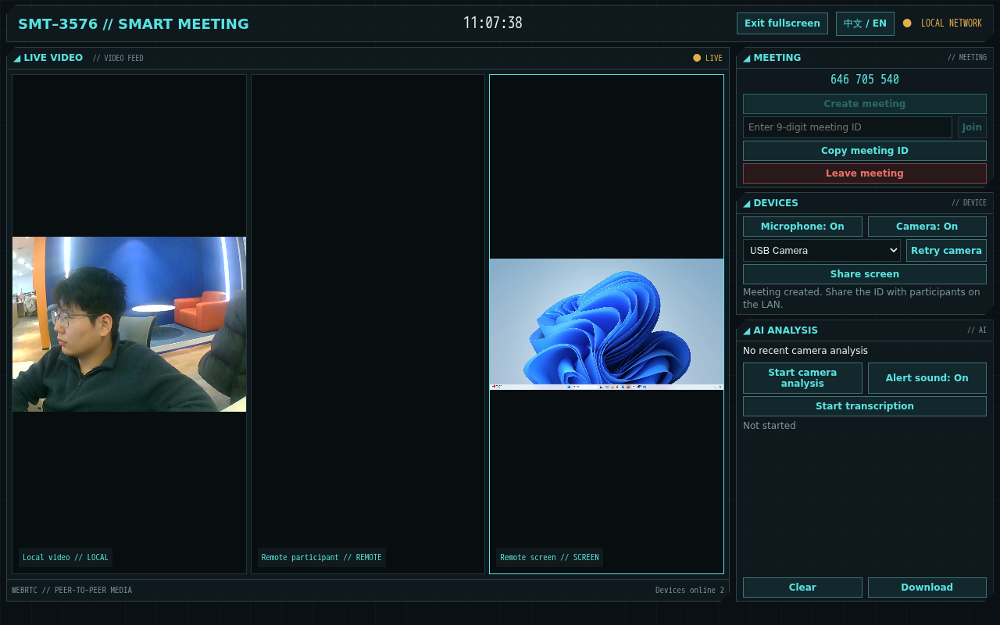
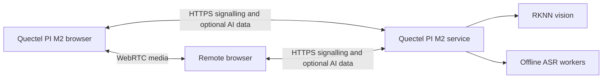

# Smart Meeting for Quectel PI M2

A self-hosted WebRTC meeting application for **Quectel PI M2**, combining browser-to-browser calls, screen sharing and optional on-board people detection, hand-raise alerts and offline speech transcription. The board hosts the service and can participate through its own Chromium application window.

[简体中文](README.zh-CN.md)



## Features

- Create a meeting with a random nine-digit ID, join by ID, copy the ID and leave cleanly.
- Up to four devices per room, with direct browser-to-browser audio and video.
- Local and remote previews, microphone/camera toggles, and audio-only or video-only fallback when combined capture fails.
- Camera selection, camera retry and a missing-frame hint.
- Share a display, window or tab as a separate video stream while keeping the camera available; late joiners can receive an ongoing share.
- Click a video or shared-screen tile to enlarge it; click again or press Esc to restore. Enter/Space works on a focused tile.
- A fullscreen button, English/Chinese interface switching and a compact desktop layout with an aligned AI panel.
- Optional YOLO people detection on the board, with local bounding-box overlays, per-camera counts and inference time.
- Pose-based hand-raise detection, an amber animated banner, source-device labels and a switchable alert tone.
- Optional offline Chinese/English streaming transcription for each device's own microphone, with partial/final text and a local input-level indicator.
- Device-labeled transcript rows, local clear/download controls and a limit of 200 rows per page.
- One startup entry point, service/window reuse and automatic shutdown of the managed service when the board application window closes.

Screen sharing sends **video only**, without system audio. Device count and detected people count are different measurements. ASR does not identify individuals sharing a microphone, translate speech or generate meeting summaries.

## Requirements

### Hardware

- Quectel PI M2 with compatible ARM64 desktop firmware and, for vision, the RK3576 RKNN runtime.
- A browser-accessible USB UVC camera and microphone/audio input.
- Speakers or a headset for remote audio and hand-raise tones.
- A display, keyboard and mouse for the board application window. A 1280×800 display is a common demonstration setup.
- A reachable local network and at least one additional browser device for a two-party demonstration.

Quectel PI M2 provides a single platform for the meeting service, desktop interface and local AI experiments. Actual call capacity, frame rate and recognition quality depend on the firmware, models, devices and workload; the four-device limit is not a performance guarantee.

### Software and runtime assets

- Python, OpenSSL, a shell and a compatible Chromium browser.
- OpenCV, NumPy and `librknnrt.so` for vision.
- A separate Python environment with sherpa-onnx/NumPy, the streaming recognizer adapter and Paraformer model files for ASR.
- Git/OpenSSH for source maintenance. Node is optional for JavaScript syntax checks, not required to run the meeting service.

On Quectel PI M2 firmware using Debian package management, basic packages can be prepared as follows:

```sh
sudo apt update
sudo apt install -y python3 openssl git openssh-client python3-opencv python3-numpy v4l-utils
```

This does **not** provision the browser, NPU driver, models or complete ASR environment. The `dependencies/` and `models/` directories are not distributed with this repository. Prepare the required assets separately using the layout below. The current service also imports an external `StreamingCommandRecognizer` adapter from `dependencies/companion-src`; that source is not bundled in this repository.

```text
dependencies/
  chromium/root/usr/lib/chromium/chromium
  asr-venv/bin/python
  companion-src/robot_companion/audio/streaming_asr.py
models/
  vision/
    yolov8n_rk3576_fp16.rknn
    yolov8n-pose.rknn
  sherpa-onnx-streaming-paraformer-bilingual-zh-en/
    encoder.int8.onnx
    decoder.int8.onnx
    encoder.onnx
    decoder.onnx
    tokens.txt
```

Install sherpa-onnx and NumPy in `asr-venv` for the device's Python version. Verify imports and model loading on the target system instead of copying a virtual environment across systems or Python versions. Vision models must match the RK3576 RKNN runtime; ASR models must match the streaming Paraformer adapter. Check the licenses of separately obtained assets.

A fresh clone can be used to set up the basic meeting service before AI assets are ready. The AI controls require the corresponding resources and compatible model outputs.

## Configuration

There is no automatic `.env` loader; set variables in the launching shell.

| Variable or option | Purpose |
| --- | --- |
| `MEETING_HOST_IP` | Board IPv4 address used when generating a new self-signed certificate |
| `MEETING_BROWSER` | Override the Chromium executable path |
| `--port 9443` | Change both the service port and the board window URL; default is 8443 |
| `--server-only` | Start/reuse the service without opening a board window |

The default browser path is `dependencies/chromium/root/usr/lib/chromium/chromium`. For a separately installed browser, supply its actual path, for example `MEETING_BROWSER=/usr/bin/chromium ./scripts/start.sh`.

The application uses an isolated browser profile in `runtime/browser-profile/`. Existing certificates are reused: changing `MEETING_HOST_IP` does not automatically replace a certificate. Keep certificate/key handling separate from code updates.

## Start the application

On a Quectel PI M2 with the required runtime assets:

```sh
git clone <REPOSITORY_URL> demo-smart-meeting
cd demo-smart-meeting
MEETING_HOST_IP=192.168.1.50 ./scripts/start.sh
```

Replace `<REPOSITORY_URL>` with the published repository's clone URL and `192.168.1.50` with the board's actual IPv4 address.

Other devices open **`https://<BOARD-IP>:8443/`**, verify/handle the first-use self-signed certificate prompt and grant camera/microphone permissions. Use a trusted certificate for a maintained deployment.

```sh
# Keep a standalone service for remote participants
./scripts/start.sh --server-only

# Use a different HTTPS port
./scripts/start.sh --port 9443
```

A normal launch from a board desktop terminal starts or reuses the service and window. Repeating the command reuses an existing instance. A non-desktop SSH session can start the service, but opening the board window requires a desktop session.

In normal window mode, closing the board application and allowing its Chromium main process to exit stops the launcher-managed service and releases its port, disconnecting other participants. `--server-only` keeps the service running; opening a managed window normally again restores window-coupled shutdown. There is no boot-time autostart configuration.

## Use the meeting

1. Click **Create meeting** on one device and share the nine-digit ID.
2. On another device, open the same board address, enter the ID and click **Join**.
3. Confirm video and sound. Use the device controls to toggle the microphone/camera or select/retry a camera. Starting with audio only requires rejoining to add an initial camera track.
4. Click **Share screen** and choose a source in the browser picker. Use **Stop sharing** or the browser's own stop control to end it.
5. Click **Start camera analysis** on each device whose camera should be analyzed. Its browser sends small snapshots to Quectel PI M2; boxes appear only on that device's local video, while count/hand-raise summaries are shared in the room.
6. Keep shoulders and wrists visible, raise a hand and hold briefly. Consecutive detections trigger the banner and optional tone; lowering the hand clears it after consecutive negative results. Detection can miss or misclassify gestures.
7. Click **Start transcription** on every device whose microphone should be transcribed. Wait for `ASR_STREAMING`, speak and watch **Local microphone level**. Seeing remote text does not mean your own transcription has started.
8. Clear or download the current page's transcript, then use **Leave meeting** to leave without closing the application. The room is removed when its final member leaves.

The board runs the recognizer locally; microphone PCM is uploaded to the board over HTTPS. Transcript labels identify devices, not individual people. Interface language switching leaves recognized speech unchanged.

## Network and current scope



- The server handles signalling, static files and explicitly enabled AI processing; ordinary meeting media travels directly between browsers.
- This is a trusted-LAN prototype. `iceServers` is empty: there is no configured STUN/TURN service, SFU or MCU. Public-network, mobile-network and complex NAT operation is not guaranteed.
- There are session credentials, but no user accounts, meeting passwords or host access controls. Knowing a valid meeting ID is enough to attempt joining.
- People are counted separately in each camera view. Overlapping views cannot be summed into a deduplicated room headcount.
- Vision uses low-frequency snapshots; ASR has finite queues and up to four registered sessions across the service. Busy processing or slow uploads can drop data.
- No meeting recording, persistent transcript database, automatic reconnection, speaker diarization, translation, cloud integration or Miracast/AirPlay receiver is included.
- This implementation uses native browser WebRTC and Python; it does not use TUIRoomKit or interoperate with third-party meeting IDs.

## Output and troubleshooting

- `runtime/server.log`: service and ASR diagnostic output; not a transcript archive.
- `runtime/browser.log`: browser startup/rendering errors.
- `runtime/launcher.log`: window-exit monitor diagnostics.
- `runtime/cert.pem`, `runtime/key.pem`, `runtime/browser-profile/`: private local runtime data, excluded from Git.
- **Download** exports the current page's text as `会议转写.txt` to the browser's download location.
- Transcripts live in page memory. **Clear** affects only that page; leaving a meeting alone does not erase already displayed rows. Refreshing or closing the page discards them, and new joiners receive no earlier transcript history.

If local transcription is absent, start it on that device, check `ASR_STREAMING`, microphone mute and the input-level meter. If the camera is black, check device permissions, selection and occupancy, then retry; valid capture frames do not rule out a browser rendering problem.

For startup failures, inspect the relevant log. The launcher can recover missing authorization for a matching current-user Xwayland session, but it still needs an active desktop to open a window. Run as the desktop user. A reported foreign port conflict should be investigated rather than resolved by killing an unknown process.

## Project structure

```text
src/             Web interface, HTTPS/signalling, launcher and AI adapters
scripts/         Single startup entry, Git and board synchronization helpers
tests/           Running-service API integration test
images/          Documentation images
models/          Prepare locally; directory excluded from distribution and Git
dependencies/    Prepare locally; directory excluded from distribution and Git
runtime/         Local certificates, logs and browser data; excluded
```

## Development and tests

```sh
python3 -m compileall -q src
for script in scripts/*.sh; do sh -n "$script"; done
# Optional, if Node is installed:
node --check src/static/app.js
```

The integration test needs an already running development service and creates temporary rooms:

```sh
MEETING_TEST_URL=https://127.0.0.1:8443 python3 -m unittest discover -s tests -v
```

It checks room capacity, credential rejection, signalling/screen-status forwarding, selected AI validation and cleanup. It does not measure real-device accuracy or sustained four-party load.

Use ordinary Git commands to maintain the source. The optional `scripts/sync-board.sh` helper contains development-board connection settings; adjust its SSH destination and project path before using it in another environment. Pulling code does not reload an active meeting; restart after the meeting ends.

## Source distribution and support

The repository contains application source, not the full preinstalled Quectel PI M2 runtime image. License see [LICENSE](LICENSE). Check third-party runtime, adapter, model and image permissions separately.

Report issues with the Quectel PI M2 firmware, browser/Python version, camera/audio model, reproduction steps and sanitized logs. Never attach private keys, session credentials or private meeting content.

For product and development questions, visit the [Quectel Pi section of the Quectel forum](https://forumschinese.quectel.com/c/quectel-pi/58).
