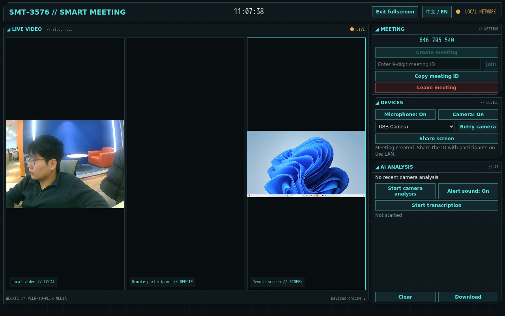
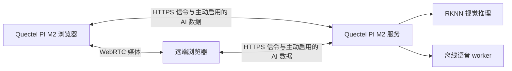

# Quectel PI M2 智能会议应用

面向 **Quectel PI M2** 的自建 WebRTC 会议应用，将浏览器音视频通话、屏幕共享和板端离线人员检测、举手提示、语音转写整合在同一界面。开发板既承载服务，也可通过本机 Chromium 应用窗口参会。

[English README](README.md)



## 功能

- 创建随机 9 位会议号，按会议号加入、复制会议号、离开和清理成员。
- 每场最多 4 台设备，浏览器间直接传输音视频。
- 本机和远端预览、麦克风/摄像头开关，采集失败时尝试仅音频或仅视频模式。
- 摄像头选择、重试和无帧提示。
- 独立共享屏幕、窗口或标签页，保留摄像头画面；后加入设备可接收正在进行的共享。
- 点击画面放大，再次点击或 Esc 恢复；支持 Tab 聚焦后使用 Enter/空格。
- 全屏按钮、中英文切换、板端紧凑布局和左右面板底边对齐。
- 可选板端 YOLO 人员检测、本机人员框、各设备画面人数及推理耗时。
- 姿态举手识别、琥珀色闪烁提示、来源设备标注和提示音开关。
- 每台设备本机麦克风的中英双语离线流式转写、中间/最终文本及音量指示。
- 来源设备标签、当前页面清空和文本下载，最多保留 200 条转写行。
- 单入口启动，复用服务和窗口，关闭板端应用后停止受管理服务并释放端口。

屏幕共享目前**只发送视频，不发送系统声音**。在线设备数与画面人数是两项指标。转写不区分共用一个麦克风的具体人员，也不做语音翻译或会议总结。

## 运行要求

### 硬件

- Quectel PI M2，使用兼容的 ARM64 桌面固件；视觉功能需要 RK3576 RKNN 运行环境。
- 可被浏览器访问的 USB UVC 摄像头、麦克风或兼容音频输入。
- 播放远端语音和提示音的扬声器或耳机。
- 用于板端窗口的显示器、键盘和鼠标；常用演示分辨率为 1280×800。
- 可互通的局域网，以及至少一台用于双端验证的其他浏览器设备。

Quectel PI M2 将会议服务、桌面交互和本地 AI 实验集中到同一平台。实际帧率、容量和识别效果取决于固件、模型、外设和负载，四设备上限不等于四方性能保证。

### 软件与离线资源

- Python、OpenSSL、Shell 和兼容的 Chromium。
- 视觉需要 OpenCV、NumPy、`librknnrt.so` 及两个 RKNN 模型。
- 转写需要独立 Python 环境、sherpa-onnx/NumPy、流式识别适配层和 Paraformer 模型。
- Git/OpenSSH 用于维护；Node 仅可选用于 JavaScript 语法检查，不是会议服务运行依赖。

在采用 Debian 包管理的 Quectel PI M2 固件上，基础依赖可按实际版本准备：

```sh
sudo apt update
sudo apt install -y python3 openssl git openssh-client python3-opencv python3-numpy v4l-utils
```

这不会安装浏览器、NPU 驱动、权重或完整 ASR 环境。本仓库不附带 `dependencies/` 和 `models/` 目录，请按以下布局自行准备所需资源。当前 ASR 还从 `dependencies/companion-src` 导入外部 `StreamingCommandRecognizer` 适配代码，该源码没有随本仓库发布。

```text
dependencies/
  chromium/root/usr/lib/chromium/chromium
  asr-venv/bin/python
  companion-src/robot_companion/audio/streaming_asr.py
models/
  vision/
    yolov8n_rk3576_fp16.rknn
    yolov8n-pose.rknn
  sherpa-onnx-streaming-paraformer-bilingual-zh-en/
    encoder.int8.onnx
    decoder.int8.onnx
    encoder.onnx
    decoder.onnx
    tokens.txt
```

在 `asr-venv` 中安装与设备 Python 版本匹配的 sherpa-onnx 和 NumPy。应在目标系统验证导入和模型加载，不要跨系统或跨 Python 版本直接复用虚拟环境。视觉模型须兼容 RK3576 RKNN 运行库，ASR 模型须匹配流式 Paraformer 适配层；另行获取的资源需核实其使用许可。

基础会议可以在 AI 资源准备完成前先验证；启用相应 AI 控件时仍需要对应资源及兼容的模型输出格式。

## 配置

应用不自动读取 `.env`，配置通过启动时的环境变量或参数传入。

| 变量或选项 | 用途 |
| --- | --- |
| `MEETING_HOST_IP` | 首次生成自签名证书时使用的板卡 IPv4 |
| `MEETING_BROWSER` | 覆盖 Chromium 可执行路径 |
| `--port 9443` | 同时更改服务和板端窗口端口，默认 8443 |
| `--server-only` | 只启动或复用服务，不打开窗口 |

默认浏览器位于 `dependencies/chromium/root/usr/lib/chromium/chromium`。如果固件已安装其他兼容浏览器，可按真实路径运行，例如 `MEETING_BROWSER=/usr/bin/chromium ./scripts/start.sh`。

浏览器使用独立的 `runtime/browser-profile/` 配置。已有证书会复用，改变 `MEETING_HOST_IP` 不会自动替换证书；证书维护应与代码更新分开处理。

## 启动应用

在已准备运行资源的 Quectel PI M2 桌面终端执行：

```sh
git clone <REPOSITORY_URL> demo-smart-meeting
cd demo-smart-meeting
MEETING_HOST_IP=192.168.1.50 ./scripts/start.sh
```

将 `<REPOSITORY_URL>` 换成发布后的仓库克隆地址，`192.168.1.50` 换成板卡真实 IPv4。

其他设备访问 **`https://<板卡IP>:8443/`**，核对并处理首次自签名证书提示，允许摄像头与麦克风。长期部署应使用可信证书。

```sh
# 保持独立服务，供其他设备参会
./scripts/start.sh --server-only

# 使用其他 HTTPS 端口
./scripts/start.sh --port 9443
```

在桌面终端普通启动时，启动器自动启动或复用服务与窗口。重复运行会复用现有实例。无桌面环境的 SSH 终端可以启动服务，但窗口需在板端桌面会话中打开。

正常窗口模式下，关闭应用且对应 Chromium 主进程退出后，会停止启动器管理的服务、释放端口并使远端断开。`--server-only` 保持服务；再次正常打开受管窗口会恢复随窗口退出的行为。项目没有配置开机自启动。

## 使用流程

1. 一台设备点击“创建并加入会议”，将 9 位会议号分享给其他人。
2. 第二台设备打开同一板卡服务地址，输入号码后点击“加入”。
3. 确认双方声音和画面，按需开关麦克风/摄像头、选择或重试摄像头。仅音频加入后首次添加摄像头需要重新入会。
4. 点击“共享屏幕”并在浏览器选择内容，用“停止共享屏幕”或浏览器停止控件结束。
5. 每台希望分析画面的设备分别开启“本机画面分析”。浏览器向 Quectel PI M2 发送小尺寸画面；人员框只显示在该设备本机视频，人数和举手摘要在会议中共享。
6. 保持肩部和手腕可见，举手并停留片刻，连续检测后触发提示条与可选提示音。连续未举手结果会解除提示；模型可能误检或漏检。
7. 每台希望被转写的设备各自开启“本机语音转写”，等待 `ASR_STREAMING`，说话并观察本机音量条。看到远端文字不等于本机已启动转写。
8. 按需清空或下载当前页面记录，用“离开会议”退出当前设备而保留应用窗口；最后一人退出后房间删除。

识别在 Quectel PI M2 本地运行，本机麦克风 PCM 通过 HTTPS 上传板卡处理。文本来源标注设备而不是具体人员；切换界面语言不会翻译识别正文。

## 网络与当前范围



- 服务端处理信令、网页和主动开启的 AI 数据；常规会议媒体在浏览器间直接传输。
- 当前为受信任局域网原型，`iceServers` 为空，没有 STUN/TURN、SFU 或 MCU。不能保证公网、移动网络或复杂 NAT 可用。
- 每个会话有凭证，但没有账户、会议密码或主持人权限；知道有效会议号即可尝试加入。
- 不同摄像头画面可能重复包含同一人，人数不能直接相加为去重后的会议总人数。
- 视觉采用低频抽帧，ASR 有限队列且服务全局最多登记四路会话，过载或慢上传可能丢失数据。
- 没有会议录制、持久化字幕库、完整自动重连、说话人分离、自动翻译、云服务整合或 Miracast/AirPlay 接收功能。
- 当前使用浏览器原生 WebRTC 与 Python，未使用 TUIRoomKit，不与第三方会议号互通。

## 输出与排查

- `runtime/server.log`：服务和 ASR 诊断，不是转写全文存档。
- `runtime/browser.log`：浏览器启动与显示环境错误。
- `runtime/launcher.log`：窗口退出监控诊断。
- `runtime/cert.pem`、`runtime/key.pem`、`runtime/browser-profile/`：本机私有运行数据，不上传 Git。
- 下载按钮导出当前页面文字为 `会议转写.txt`，保存位置由浏览器决定。
- 转写只在页面内存；清空只影响本页，仅离开会议不会删除已有文本。刷新或关闭页面会丢失记录，新参会者不会取得此前的转写历史。

本机没有转写时，先启动本机功能、确认 `ASR_STREAMING`、麦克风非静音及音量条变化。摄像头黑屏时检查权限、选中设备及占用后重试；有采集帧也不能排除浏览器渲染问题。

启动失败时查看对应日志。启动器可以为匹配当前用户的 Xwayland 会话补充授权，但仍需有效桌面会话；请使用桌面用户运行。其他程序占用端口时先核实进程归属，不要随意结束未知程序。

## 项目结构

```text
src/             网页、HTTPS/信令、启动管理与 AI 适配
scripts/         统一启动入口、Git 与板端代码同步工具
tests/           运行中服务的接口集成测试
images/          说明图片
models/          自行准备，不随源码分发且不入库
dependencies/    自行准备，不随源码分发且不入库
runtime/         本机证书、日志和浏览器数据，不入库
```

## 开发与测试

```sh
python3 -m compileall -q src
for script in scripts/*.sh; do sh -n "$script"; done
# 可选，需要已安装 Node
node --check src/static/app.js
```

先启动开发服务，再运行会创建临时房间的集成测试：

```sh
MEETING_TEST_URL=https://127.0.0.1:8443 python3 -m unittest discover -s tests -v
```

测试覆盖房间容量、凭证拒绝、信令和屏幕状态转发、部分 AI 参数校验与清理，不代表真实设备识别准确率或四方持续负载测试。

使用普通 Git 命令维护源码。可选的 `scripts/sync-board.sh` 包含开发板连接配置，在其他环境使用前请调整 SSH 目标和板端项目路径。拉取更新不会重新加载已运行会议，请在会议结束后重新启动。

## 源码分发与技术支持

仓库提供应用源码，不包含完整的 Quectel PI M2 预装运行镜像。授权详见 [LICENSE](LICENSE)

反馈时请提供 Quectel PI M2 固件、浏览器/Python 版本、摄像头及音频型号、复现步骤和脱敏日志，避免提交私钥、会话凭证或私人会议内容。

产品及开发问题可在[移远官方论坛 Quectel Pi 版块](https://forumschinese.quectel.com/c/quectel-pi/58)交流。
